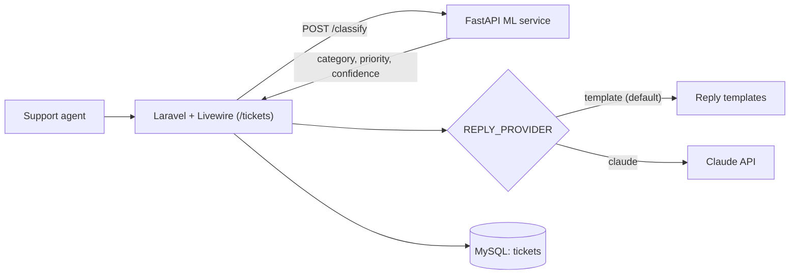

# Support Ticket Classifier

A Laravel app that sends each support ticket to a small FastAPI service. A scikit-learn model returns a category, a priority, and a confidence score. Tickets the model is unsure about are flagged for a person to review.

> **Status:** working prototype. The model is trained on synthetic data, so its accuracy numbers mean nothing yet. The [Known limitations](#known-limitations) section explains why and what I plan to change.

<!-- Add a screenshot of the /tickets page here: -->
<!--  -->

## What it does

- An agent pastes a customer message on the `/tickets` page.
- The ML service returns a **category** (`technical`, `billing`, `account`, `feature_request`, `other`), a **priority**, and a **confidence** value for each.
- If the confidence is below **0.6**, the ticket is marked "needs human review".
- The app suggests a reply based on category and priority.
- Tickets are saved in MySQL, shown with the highest priority first, and can be marked as resolved.
- The demo data has Arabic and English messages.

## Design choices

- **Two services, one fixed contract.** The model is Python, the product is Laravel. They only talk through the JSON contract below, so either side can change without touching the other.
- **Confidence is used, not just shown.** A low score sends the ticket to a person instead of trusting the model.
- **Replies are switchable.** `REPLY_PROVIDER` picks templates or the Claude API. Templates are the default, so the app runs without any paid service.
- **Laravel code is split by job.** The Livewire component runs the steps, `TicketClassifierService` talks to the ML service, `ReplySuggestionService` produces the reply, and `Ticket` holds the data rules.
- **Config lives in `.env`.** No keys or URLs in code, and the trained model files are not committed.

## Architecture



## Tech stack

| Part | Technology |
|---|---|
| Web app | Laravel 13, Livewire 4, PHP 8.4+, MySQL 8 |
| ML service | Python 3.12, FastAPI, scikit-learn 1.5.2, pandas, joblib |
| Model | TF-IDF (1-2 word n-grams) + Logistic Regression, one model for category and one for priority |
| Styling | Tailwind CSS from a CDN (development only) |

## ML service API

### `POST /classify`

Request body:

```json
{ "text": "My internet connection is not working" }
```

`text` is required and must be 3 to 2000 characters.

Response:

```json
{
  "category": "technical",
  "priority": "medium",
  "category_confidence": 0.41,
  "priority_confidence": 0.398
}
```

This sentence does not look like any training template, so confidence is low (0.41) and the app would flag the ticket for review.

Errors:

| Status | When |
|---|---|
| 422 | the body is missing `text`, or `text` is too short or too long |
| 503 | the models are not loaded |

### `GET /health`

```json
{ "status": "ok", "models_loaded": true }
```

### How Laravel handles failures

- If the service can't be reached, `TicketClassifierService` logs the error and throws a `RuntimeException` with a message the page can show.
- If it answers with an error status, the status and body are logged and a generic message is shown.
- The response keys are not validated yet. See the roadmap.

## Database

One table, `tickets`: `id`, `user_id`, `raw_text`, `category`, `priority`, `category_confidence`, `priority_confidence`, `suggested_reply`, `status`, and timestamps. `category`, `priority` and `status` are enums. The exact definition is in `database/migrations/`.

## How classification works

1. **Data** (`ml_service/generate_data.py`): 300 labeled rows, 60 per category, built from message templates with random fill-ins.
2. **Training** (`ml_service/train.py`): a scikit-learn `Pipeline` of `TfidfVectorizer` and `LogisticRegression`, trained on an 80/20 stratified split and saved with `joblib`. Saving the whole pipeline means text is transformed at prediction time exactly as it was in training.
3. **Serving** (`ml_service/serve.py`): FastAPI loads both models once at startup and validates input with Pydantic.
4. **Confidence**: the highest `predict_proba` value is returned. Laravel flags anything under 0.6.

## Reply suggestions

- `template` (default): a reply picked by category, with an extra line for `high` and `urgent`. Free and instant, and no customer text leaves the app.
- `claude`: asks the Claude API for a draft reply, using category and priority as context. Needs `ANTHROPIC_API_KEY` and account credit.

With `claude`, an API failure currently stops the save, so the ticket is lost. The fix is a nested `try` that saves the ticket without a reply. See the roadmap.

## Project structure

```text
app/
  Livewire/TicketDesk.php            # page logic: classify, suggest, save
  Models/Ticket.php                  # Eloquent model, scope, review rule
  Services/
    TicketClassifierService.php      # HTTP client for the ML service
    ReplySuggestionService.php       # template or Claude replies
resources/views/
  layouts/app.blade.php              # page layout
  livewire/ticket-desk.blade.php     # ticket form and list
database/migrations/                 # tickets table
ml_service/
  generate_data.py                   # synthetic training data
  train.py                           # train, evaluate, save models
  serve.py                           # FastAPI app
  requirements.txt
```

## Getting started

### Requirements

PHP 8.4+, Composer, MySQL 8, Python 3.12.

### 1. Laravel app

```bash
composer install
cp .env.example .env
php artisan key:generate
# set DB_* in .env, then:
php artisan migrate
```

### 2. ML service

```bash
cd ml_service
python -m venv venv
# Windows: venv\Scripts\activate    macOS/Linux: source venv/bin/activate
pip install -r requirements.txt
python generate_data.py
python train.py
uvicorn serve:app --host 0.0.0.0 --port 8001
```

Check it: `http://localhost:8001/health` should return `{"status":"ok","models_loaded":true}`.

### 3. Run the app

```bash
php artisan serve
```

Open `http://localhost:8000/tickets`.

### Environment variables

| Variable | Purpose | Example |
|---|---|---|
| `ML_CLASSIFIER_URL` | where Laravel reaches the ML service | `http://127.0.0.1:8001` |
| `REPLY_PROVIDER` | `template` or `claude` | `template` |
| `ANTHROPIC_API_KEY` | only for `claude` | *(empty)* |
| `ANTHROPIC_MODEL` | only for `claude` | *(model name)* |

Never commit `.env`. The `*.joblib` files and the generated CSV are ignored by git and recreated by `generate_data.py` and `train.py`.

## Running and debugging notes

Things that cost me time while building this:

- **Start `uvicorn` from inside `ml_service/`.** The model paths are relative, so starting it elsewhere fails to find the `.joblib` files.
- **Keep the scikit-learn version pinned.** A model saved with one version may not load with another.
- **After changing `.env`, run `php artisan config:clear`.** Laravel reads the cached config otherwise.
- **If Laravel runs in a container, `localhost` is the container itself.** Point `ML_CLASSIFIER_URL` at the ML service's container name, or at the host.
- **Logs:** `storage/logs/laravel.log`. A failed call to the ML service is logged as `TicketClassifierService: connection failed`.

## Testing

No automated tests yet. Planned:

- A Laravel feature test for submitting a ticket, with the ML service faked using `Http::fake`.
- Tests for `/classify` in Python with Arabic and English input.

## Known limitations

- **The accuracy is not meaningful.** Each category has 8 templates, and the same template shows up in both the training and test splits. Held-out accuracy is close to 100%, which comes from data leakage, not from a good model.
- **No `urgent` examples.** The urgency rule looks for words no template contains, so the model can never predict `urgent`.
- **The priority model mostly learns my rule.** In the demo data, priority comes from category (billing is always `high`), so the model is nearly redundant. Real priority needs labels from people.
- **Arabic handling is basic.** TF-IDF treats different word forms and spellings as separate words, and there is no text normalization.
- **Probabilities are not calibrated.** Confidence is a signal, not a guarantee.
- **A failed reply can lose the ticket** when `REPLY_PROVIDER=claude` (see above).
- **No authentication.** Anyone who can open the page can resolve any ticket.
- **The priority ordering uses MySQL's `FIELD()`**, so it won't run on SQLite.

## Roadmap

1. Replace the synthetic data with anonymized real or realistic messages, and evaluate properly: a hand-written test set, cross-validation, a confusion matrix.
2. Save the ticket even when the reply step fails.
3. Check the keys in the ML response before using them.
4. Add the tests listed above, and run them in CI.
5. Add Arabic text normalization and try character n-grams.
6. Rule-based urgency detection, and rework or drop the priority model.
7. Calibrate confidence and choose the review threshold from data.
8. Authentication and per-team ticket separation.
9. A Docker Compose setup that starts everything with one command.

## Author

Fatema Al-Showaf, backend developer (Laravel/PHP)